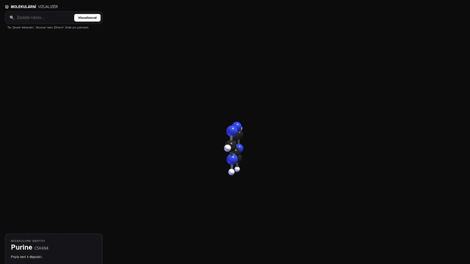

# Molecular Studio: 3D molecule visualizer with PubChem data

[Česky](README.cs.md)

> Online version / Live 3D web app: [https://school.vibemaker.cz/spa/molekuly.html](https://school.vibemaker.cz/spa/molekuly.html)  
> *(Run directly in your browser · No installation · No API key required)*

An interactive 3D viewer for chemical molecules. Type an English molecule
name, the app fetches structural data from the public PubChem database
(NIH/NCBI) and renders a ball-and-stick model with CPK element coloring.
No API key, no database and no accounts are required.

## Run

Verified against the scripts in `package.json`; the installation was not
executed end-to-end in this documentation pass.

1. Clone the repository and open it in a terminal.
2. `npm install` (or `yarn install`)
3. `npm run dev` and open `http://localhost:3000`

Requires Node.js for Next.js 14. Production: `npm run build` and
`npm start`. No environment variables are needed; the bundled Prisma schema
is unused (`lib/db.ts` exports a null client, the app reads PubChem only).

## Features

- Search by English molecule name (for example Caffeine, Aspirin, Ethanol);
  queries go through the app's own API route to PubChem
- Interactive 3D scene with rotation and zoom, built with Three.js
- CPK element coloring and single, double and triple bonds
- Molecule information: formula, mass and atom count
- No API key, no database, no telemetry

## What it is not

Not a molecule editor and not a computational chemistry tool: no
measurements, no force fields, no molecular dynamics. The model is limited
to the structural data PubChem returns for a given compound. The interface
is Czech only; molecule names must be entered in English because PubChem
search expects English nomenclature.

## Languages

The application interface is Czech. This README exists in English (this
file) and Czech ([README.cs.md](README.cs.md)); both editions carry the
same facts.

## Data and privacy

Search queries are sent from the app's own API route to the public PubChem
REST service. There is no database, no account system, no analytics and no
cookies. A self-hosted copy sends its queries from your server to PubChem.

## Files

| Path | Purpose |
|---|---|
| `app/page.tsx` | Page state and layout |
| `app/api/molecule/route.ts` | Server route fetching PubChem data |
| `components/three-scene.tsx`, `components/molecule-viewer.tsx` | 3D rendering |
| `components/ui-overlay.tsx` | Search interface |
| `lib/constants.ts` | CPK colors and constants |

## Documentation

- [Deployment guide](DEPLOYMENT_GUIDE.md) (Vercel and alternatives)

## License and author

MIT, copyright © 2026 Luděk Sušický. See [LICENSE](LICENSE).

### Author

**Luděk Sušický** — biologist, secondary-school and university teacher of computing subjects

- E-mail: [ludek.susicky@gmail.com](mailto:ludek.susicky@gmail.com)
- X: [@ludeksusicky](https://x.com/ludeksusicky)
- LinkedIn: [Luděk Sušický](https://www.linkedin.com/in/ludek-susicky/)
- GitHub: [@siberius](https://github.com/siberius) — more educational projects and open-source applications

The app is an example of an SPA (Single Page Application) in a single HTML file / interactive 3D viewer.

[GitHub repository](https://github.com/siberius/molekularni-studio)
